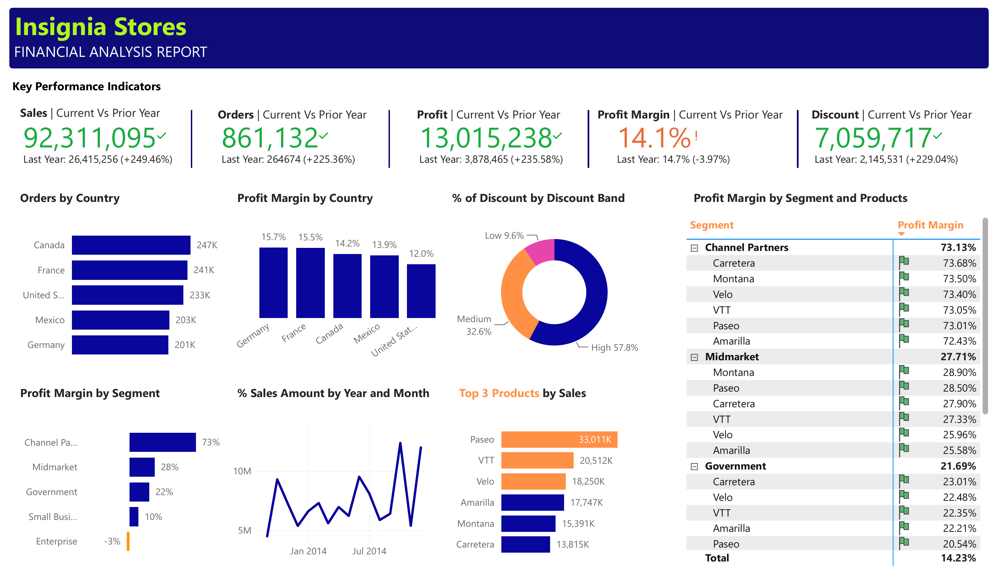

# Insignia Stores: Financial Analysis Report (Power BI)

A one-page Power BI dashboard that tracks sales, orders, profit, profit margin and discounts for a fictional retailer. It compares the current year with the prior year and breaks results down by country, customer segment, product and discount band.

## Business questions

- How are sales, orders, profit and discounts trending against last year?
- Which countries bring in the most orders, and which are the most profitable?
- Which customer segments and products earn the best margins?
- How much revenue is given away through each discount band?
- Which three products drive the most sales?

## Key findings

- Sales reached 92.3M, up 249% on the prior year. Profit rose to 13.0M.
- Profit margin slipped from 14.7% to 14.1% even though volume grew strongly.
- High discounts make up 57.8% of all discounts given, which likely explains the margin dip.
- Channel Partners is by far the most profitable segment at 73% margin. Enterprise runs at a loss (-3%).
- Germany and France have the best margins. Canada has the most orders.
- Paseo is the top product by sales at 33.0M, followed by VTT and Velo.

## Report contents

| Visual | What it shows |
|---|---|
| 5 KPI cards | Sales, Orders, Profit, Profit Margin and Discount vs prior year |
| Bar chart | Orders by country |
| Column chart | Profit margin by country |
| Donut chart | Share of discount by discount band |
| Bar chart | Profit margin by segment |
| Line chart | Sales by year and month |
| Bar chart | Top 3 products by sales (highlighted) |
| Matrix | Profit margin by segment and product with conditional icons |

## Data model

- **Financials**: fact table from `data/Financial_Sample.xlsx` (700 rows, 2013 to 2014)
- **Date Table**: calendar table used for year over year comparisons
- **Analysis**: measures table

Measures: `Sales Amount`, `Sales Amount LY`, `Orders`, `Orders LY`, `Profit`, `Profit LY`, `Profit Margin`, `Profit Margin LY`, `Discount offered`, `Discount Offered LY`, `Top 3 Products by Sales`, `Top Highlight`

## Tools

Power BI Desktop, Power Query, DAX, Excel

## Files

| File | Description |
|---|---|
| `FinancePBI.pbix` | Power BI report |
| `FinancePBI.pdf` | PDF export of the dashboard |
| `data/Financial_Sample.xlsx` | Source data |
| `data/Financial_Sample.csv` | Same data as CSV, readable on GitHub |
| `images/dashboard.png` | Dashboard screenshot |

## How to open

Download or clone the repo and open `FinancePBI.pbix` in Power BI Desktop (Windows). If you don't have Power BI, view `FinancePBI.pdf` or the screenshot above.

The dataset is Microsoft's public Financial Sample workbook.
